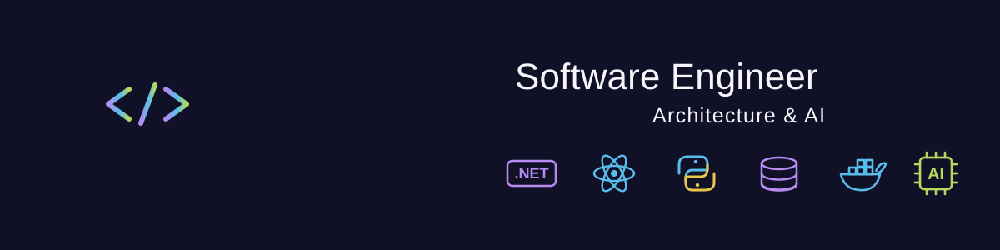

## Carina Correjidor

**Senior Software Engineer** · Software Architecture · Applied AI

I design and build reliable software across backend and frontend, with a focus on maintainable architecture, APIs and integrations. My experience includes **financial systems and digital banking**, and I'm exploring how to apply AI to real engineering workflows.

---

### What I work on

**Architecture**  
Clean Architecture · Domain-Driven Design · CQRS · System design · Maintainability

**Engineering**  
Backend & frontend · REST APIs · Integrations · Distributed systems · Testing

**Applied AI**  
AI agents · MCP · RAG · Retrieval · Python · FastAPI

### Featured work

**[Personal website & blog](https://github.com/caricorrejidor/caricorrejidor.github.io)**  
Personal website built with Astro, including content and a deployment workflow.

**[PayTrace](https://github.com/caricorrejidor/paytrace-app)**  
Python API prototype for investigating simulated payment failures using rule-based diagnostics.

### Currently exploring

- **AI agents & MCP** — connecting models to practical tools and workflows
- **RAG** — grounding intelligent applications in retrieved information
- **Reusable engineering** — architecture patterns, tests and spec-driven workflows

---

### Connect

[LinkedIn](https://linkedin.com/in/carinacorrejidor) · [Portfolio](https://caricorrejidor.github.io)
